# Push-Pull Encoder

A rotary encoder you can also push and pull, like the knobs on an Airbus FCU: turn to set a value, pull for selected, push for managed. Three inputs from one knob, in a housing just 27 mm square.

The trick is a single PCB design used twice. Fit one set of headers and it's the bottom board, fit the other and it's the top. The two stack face to face, so there's only one board to order.

This guide covers the 20 mm version, PP Stack · 20 mm.

[Before you start](#before-you-start) · [A · Bottom board](#a--bottom-board) · [B · Top board](#b--top-board) · [C · Assembly](#c--assembly)

Prefer paper? [Printable PDF](PP-Stack-assembly-guide-20mm.pdf), 3 pages.

**Files:** example assemblies (15 mm and 20 mm) and the knob are in [`CAD/`](CAD/).

## Before you start

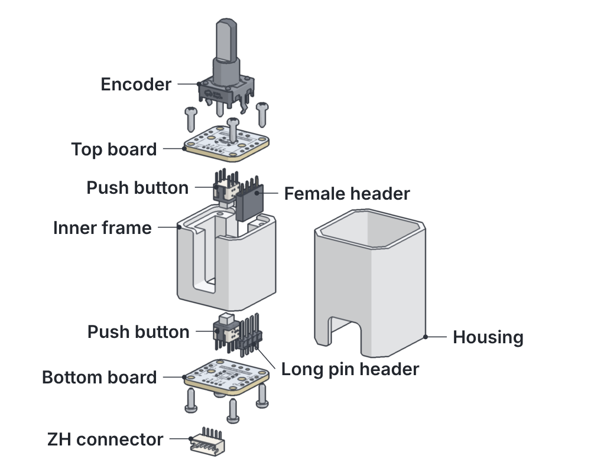

### The parts

| Qty | Part | |
|---:|---|---|
| 2 | PCB | |
| 1 | Rotary encoder | EC12E |
| 2 | Push button | SAMZO 2010751102 |
| 1 | Female header | 4 pin, 2.54 mm |
| 1 | Long pin header | 4 pin, 21 mm |
| 1 | ZH1.5 connector | 5 pin |
| 8 | Self-tapping screw | M2 |
| 1 | Inner frame + housing | printed |

Tools: soldering iron, flush cutters, small screwdriver.

 

### One PCB, two jobs

Both boards are the same PCB. The headers decide which is which:

- **Bottom board:** long pins in **U5**, next to the ring.
- **Top board:** female header in **U4**, next to the dot.

U4 and U5 are mirrored, so when the top board flips onto the bottom one the headers line up, ring over dot. The hatched slot stays empty on each board.

 

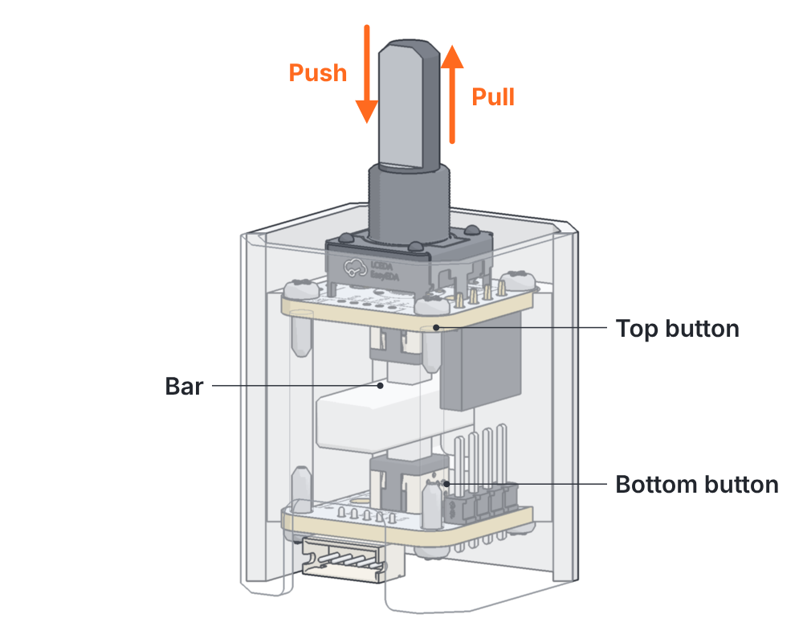

### How it works

The boards, frame and encoder move as one stack inside the housing. A bar fixed in the housing sits between the two push buttons.

- **Push:** the top board's button hits the bar.
- **Pull:** the bottom board's button hits the bar.

The buttons' own springs bring the knob back to centre.

 

---

## A · Bottom board

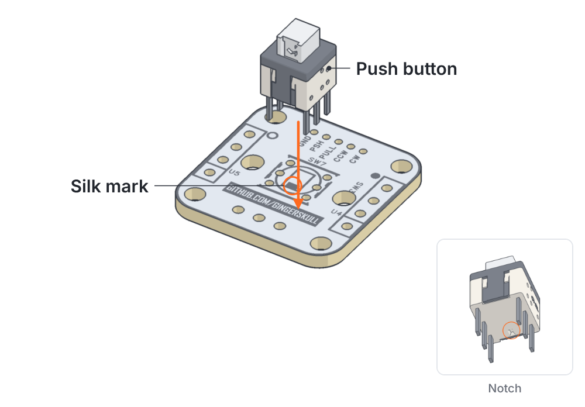

### 1 · Push button

<kbd>A · Bottom board</kbd> <kbd>Button side</kbd>

Fit SW7 with the notch on its underside **opposite** the filled mark in the SW7 outline.

> [!WARNING]
> The other way round it reads normally-closed.

> [!TIP]
> Trim the legs after soldering.

 

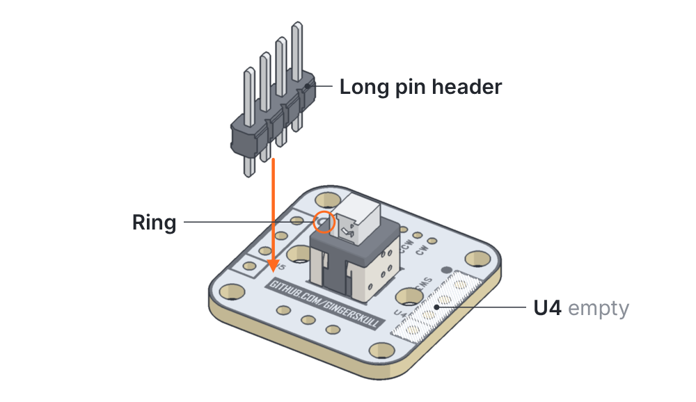

### 2 · Long pin header

<kbd>A · Bottom board</kbd> <kbd>U5</kbd>

Long pin header into **U5**, next to the ring. U4 stays empty on this board.

> [!TIP]
> Keep it square to the board. These pins mate with the top board later.

 

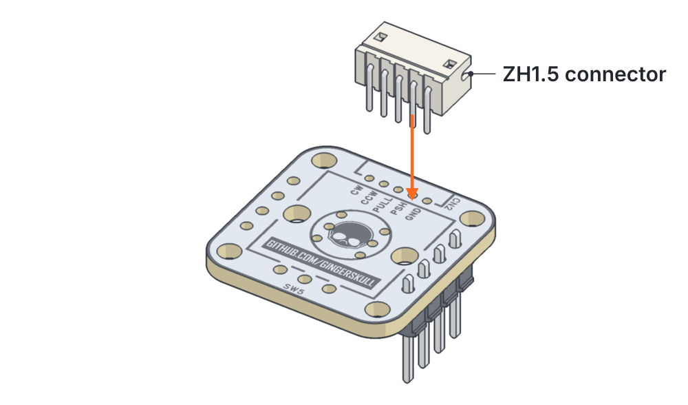

### 3 · ZH connector

<kbd>A · Bottom board</kbd> <kbd>Flip</kbd>

Flip the board. Fit CN2 with the opening facing the board edge.

 

---

## B · Top board

### 4 · Push button

<kbd>B · Top board</kbd> <kbd>Button side</kbd>

Same as step 1: notch opposite the silk mark.

> [!IMPORTANT]
> Trim the legs **flush**. The encoder sits right over them.

 

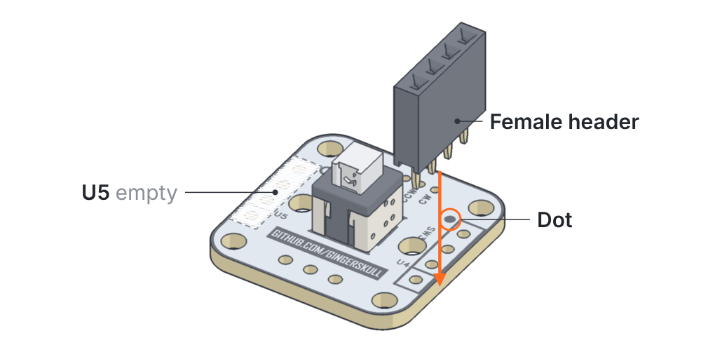

### 5 · Female header

<kbd>B · Top board</kbd> <kbd>U4</kbd>

Female header into **U4**, next to the dot. U5 stays empty on this board.

> [!NOTE]
> When the boards stack, ring meets dot.

 

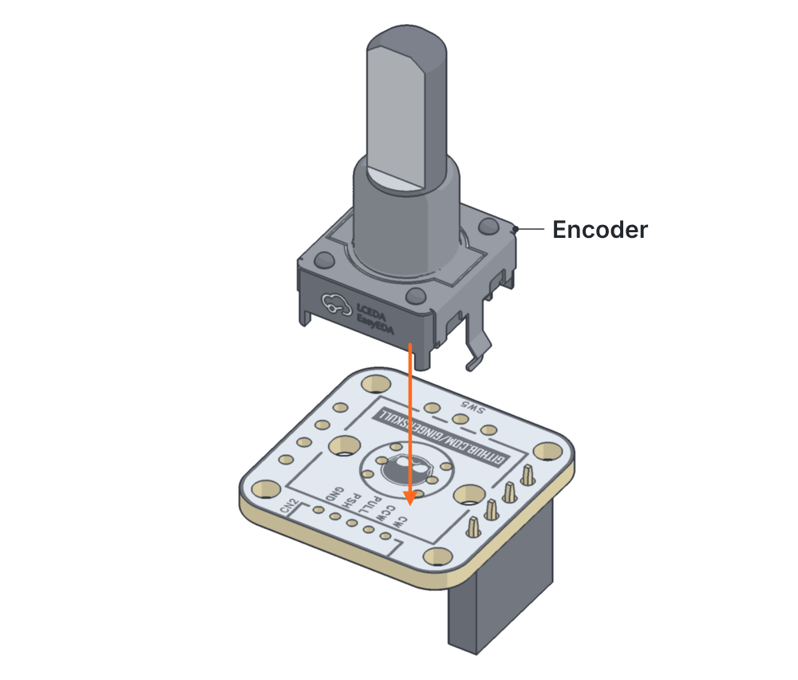

### 6 · Encoder

<kbd>B · Top board</kbd> <kbd>Flip</kbd>

Flip the board and fit the encoder.

> [!TIP]
> Solder the mounting tabs too. They carry the push/pull load.

 

---

## C · Assembly

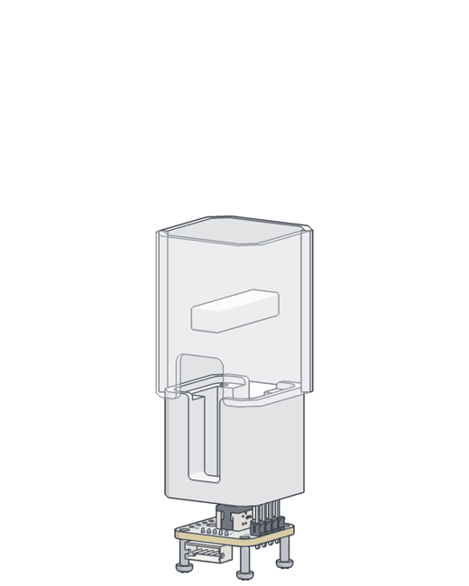

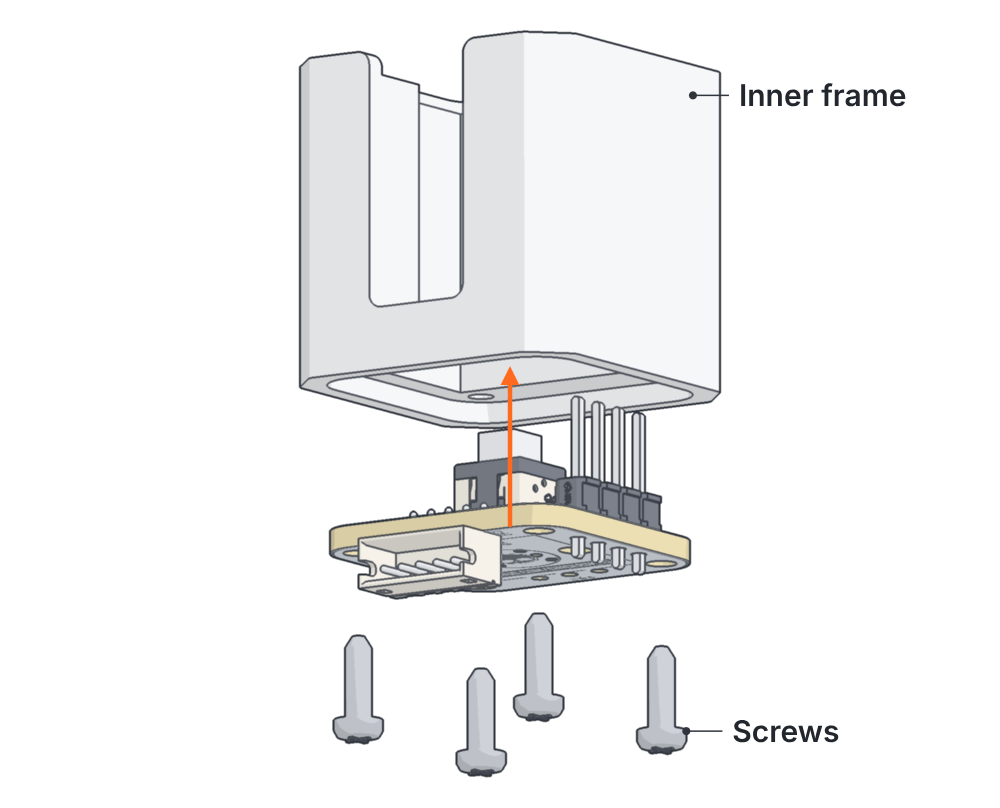

### 7 · Bottom board onto the frame

<kbd>C · Assembly</kbd> <kbd>4 × M2</kbd>

Button side into the frame, four self-tapping screws.

> [!CAUTION]
> Snug, not tight. They're cutting threads in plastic.

 

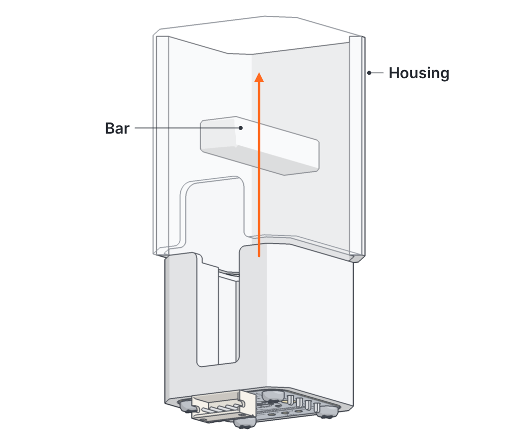

### 8 · Into the housing

<kbd>C · Assembly</kbd> <kbd>From below</kbd>

Slide the frame up into the housing. The slots pass over the bar and the connector lines up with the cutout.

> [!NOTE]
> The bar ends up between the two push buttons. That's the whole push/pull trick.

 

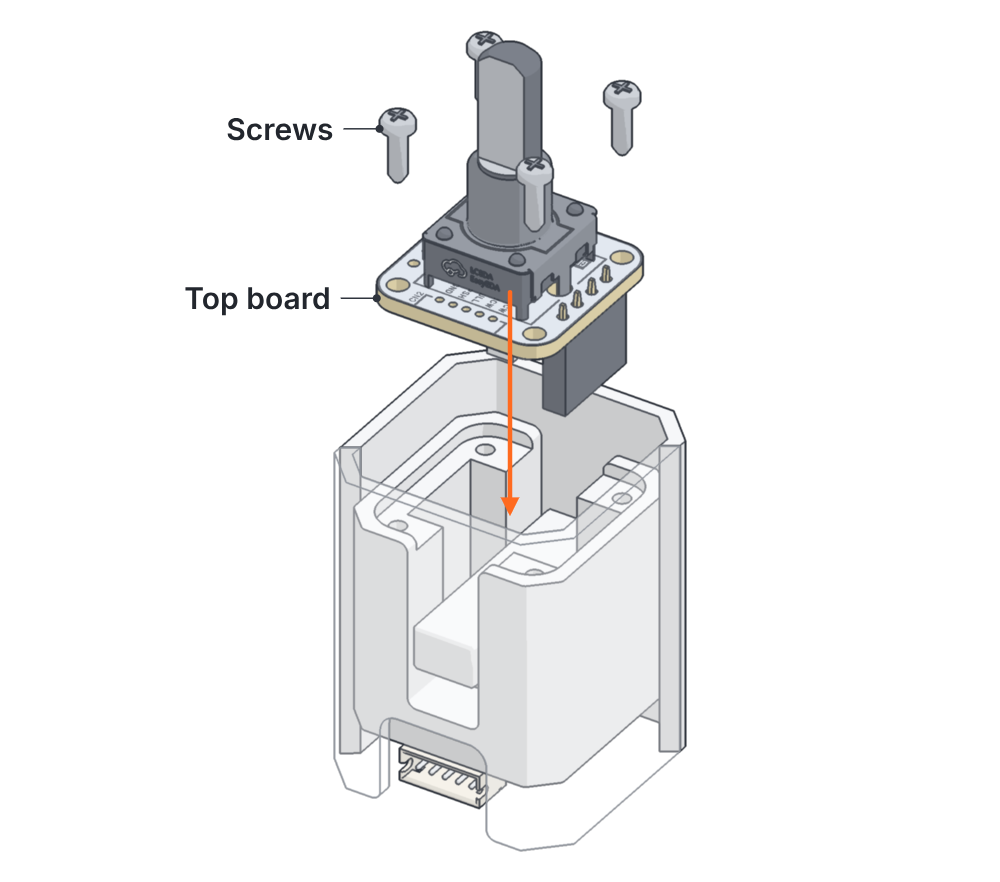

### 9 · Top board

<kbd>C · Assembly</kbd> <kbd>4 × M2</kbd>

Female header drops onto the long pins, dot over the ring. Screw it down.

> [!TIP]
> Check the pins line up before pushing down.

 

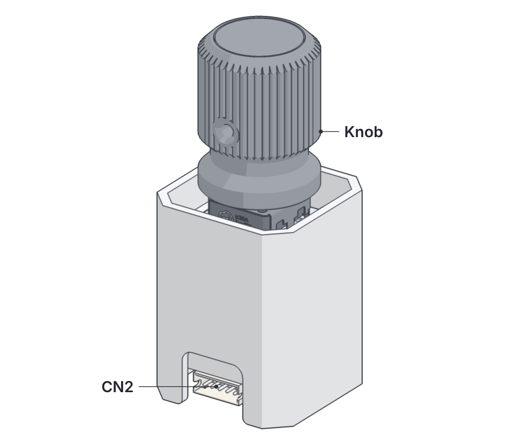

### 10 · Done

<kbd>C · Assembly</kbd>

Knob on, cable in.

| CN2 pin | Signal |
|:---:|---|
| 1 | GND |
| 2 | PULL |
| 3 | PUSH |
| 4 | CCW (A) |
| 5 | CW (B) |

 
