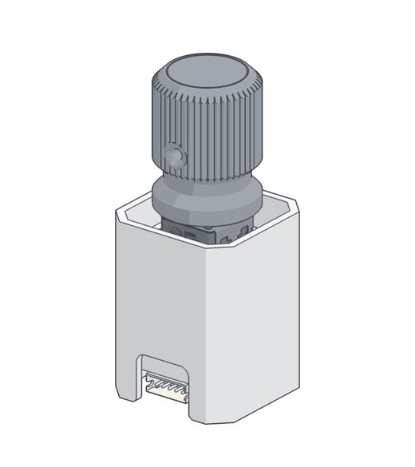
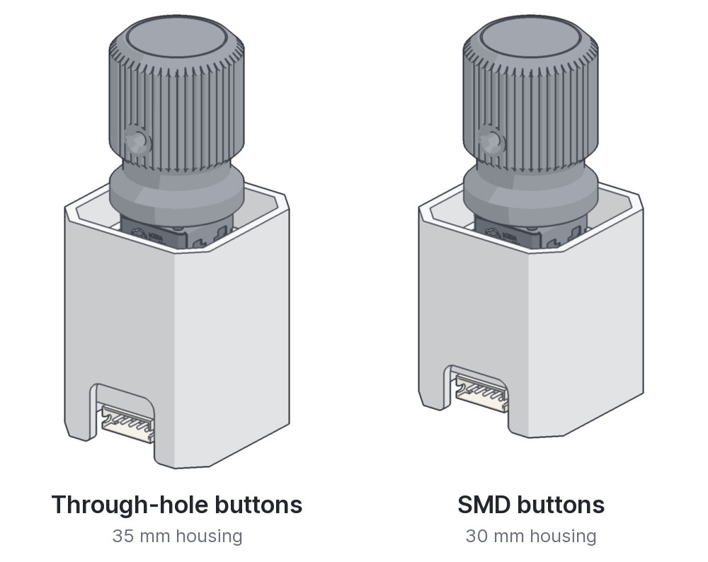
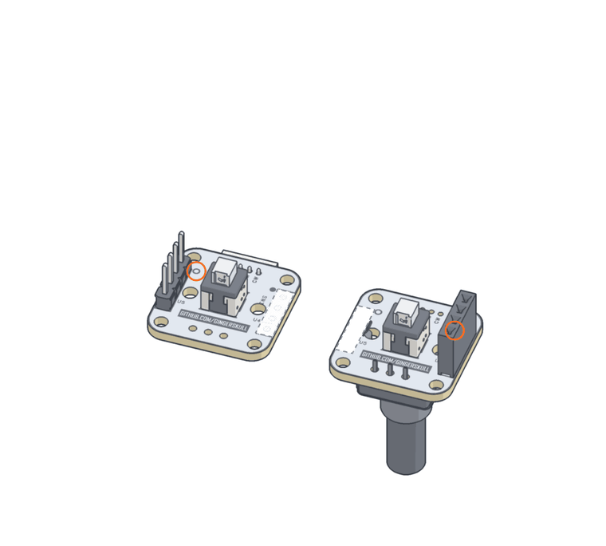

# Push-Pull Encoder

<picture><source media="(prefers-color-scheme: dark)" srcset="docs/img/hero-dark.gif"></picture>

A rotary encoder that also pushes and pulls, like the knobs on an Airbus FCU: turn to set a value, pull for selected, push for managed. It all fits in a 27 mm square housing.

Both boards come from one PCB design. The headers you fit decide which becomes the top and which the bottom, and the two stack face to face, so there's only one board design to order.

[Two versions](#two-versions) · [Parts and where to buy](#parts-and-where-to-buy) · [One PCB, two jobs](#one-pcb-two-jobs) · [How it works](#how-it-works)

## Two versions

<picture><source media="(prefers-color-scheme: dark)" srcset="docs/img/versions-dark.png"></picture>

Same PCB, encoder, headers and connector. Only the push buttons differ, and with them the gap between the boards.

| | 20 mm | 15 mm |
|:--|:--|:--|
| Push buttons | Through-hole, SAMZO 2010751102 | SMD, Panasonic EVQ9P105M |
| Long pin header | 21 mm | 17 mm |
| Housing height | 35 mm | 30 mm |
| Assembly instructions | **[20 mm instructions](docs/guide-20mm.md)** | **[15 mm instructions](docs/guide-15mm.md)** |
| Printable | [PDF, 3 pages](PP-Stack-assembly-guide-20mm.pdf) | [PDF, 3 pages](PP-Stack-assembly-guide-15mm.pdf) |

The 20 mm version is easier to solder. The 15 mm one needs 5 mm less depth behind the panel.

## Parts and where to buy

| Qty | Part | Version | Buy |
|--:|:--|:--:|:--|
| 2 | PCB | both | Order files coming soon |
| 1 | Rotary encoder, Alps EC12E2420801 | both | [LCSC](https://www.lcsc.com/product-detail/C351236.html) · [AliExpress](https://www.aliexpress.com/item/1005006583646763.html) · [Mouser](https://www.mouser.com/ProductDetail/688-EC12E2420801) |
| 2 | Push button, SAMZO 2010751102 | 20 mm | [LCSC](https://www.lcsc.com/product-detail/C41416693.html) · [AliExpress](https://www.aliexpress.com/item/1005005854541077.html) ("Flat head", "No Lock") |
| 2 | Push button, Panasonic EVQ9P105M | 15 mm | [LCSC](https://www.lcsc.com/product-detail/C79157.html) · [Mouser](https://www.mouser.com/ProductDetail/667-EVQ-9P105M) |
| 1 | Female header, 1×4, 2.54 mm | both | [LCSC](https://www.lcsc.com/product-detail/C2897367.html) · [AliExpress](https://www.aliexpress.com/item/4001198421663.html) |
| 1 | Long pin header, 1×4, 21 mm | 20 mm | [LCSC](https://www.lcsc.com/product-detail/C51353.html) · [AliExpress](https://www.aliexpress.com/item/1005001514058091.html) ("21mm") |
| 1 | Long pin header, 1×4, 17 mm | 15 mm | [LCSC](https://www.lcsc.com/product-detail/C5156622.html) · [AliExpress](https://www.aliexpress.com/item/1005001514058091.html) ("17mm") |
| 1 | ZH1.5 connector, 5 pin, right angle | both | [LCSC](https://www.lcsc.com/product-detail/C2845568.html) · [AliExpress](https://www.aliexpress.com/item/1005012352793560.html) |
| 8 | M2 × 6 self-tapping screw, pan head | both | [LCSC](https://www.lcsc.com/product-detail/C357360.html) · [AliExpress](https://www.aliexpress.com/item/4000982209705.html) |
| 1 | Inner frame + housing | each its own | Printed |
| | ZH1.5 cable, 5 pin (optional) | both | [LCSC](https://www.lcsc.com/product-detail/C53155206.html) · [AliExpress](https://www.aliexpress.com/item/1005001649158434.html) |

The pin headers come as 1×40 strips: snap off four pins.

> [!IMPORTANT]
> The frame slides up and down inside the housing, so print both accurately. They need only a minimal gap: enough for smooth push and pull, not so much that the knob wobbles. Test-fit the frame in the housing before you assemble anything.

You'll also need a soldering iron, flush cutters and a small screwdriver. For the SMD buttons, use a fine tip or a soldering hot plate. [`CAD/`](CAD/) has example assemblies of both versions plus the knob.

## One PCB, two jobs

<picture><source media="(prefers-color-scheme: dark)" srcset="docs/img/flip-dark.gif"></picture>

The headers decide which board is which. The bottom board gets the long pin header in **U5**, next to the ring. The top board gets the female header in **U4**, next to the dot.

U4 and U5 are mirror images, so when the top board flips onto the bottom one the headers line up, dot over ring. Each board leaves the other slot empty (hatched in the pictures).

  

## How it works

<picture><source media="(prefers-color-scheme: dark)" srcset="docs/img/20mm/how-it-works-dark.png"></picture>

The two boards, the inner frame and the encoder move together as one stack inside the housing. A bar fixed across the housing sits between the two push buttons.

Push the knob and the top board's button hits the bar. Pull it and the bottom board's button does. The buttons' own springs bring the knob back to centre.

| CN2 pin | Signal |
|:---:|:---|
| 1 | GND |
| 2 | PULL |
| 3 | PUSH |
| 4 | CCW (A) |
| 5 | CW (B) |

  
