# PP Stack · 20 mm

This is the 20 mm version, with through-hole push buttons. There's also a [printable PDF](../PP-Stack-assembly-guide-20mm.pdf) (3 pages). Shop links for every part are in the [parts table](../README.md#parts-and-where-to-buy).

[The parts](#the-parts) · [A · Bottom board](#a--bottom-board) · [B · Top board](#b--top-board) · [C · Assembly](#c--assembly)

<picture><source media="(prefers-color-scheme: dark)" srcset="img/20mm/parts-dark.png">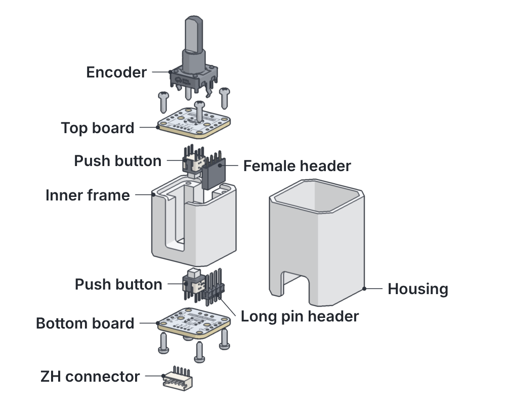</picture>

### The parts

| Qty | Part |
|--:|:---|
| 2 | PCB |
| 1 | EC12E rotary encoder |
| 2 | Push button, SAMZO 2010751102 |
| 1 | Female header, 4 pin, 2.54 mm |
| 1 | Long pin header, 4 pin, 21 mm |
| 1 | ZH1.5 connector, 5 pin |
| 8 | M2 self-tapping screw |
| 1 | Inner frame, printed (20 mm) |
| 1 | Housing, printed (20 mm) |

You'll also need a soldering iron, flush cutters and a small screwdriver.

  

---

## A · Bottom board

<picture><source media="(prefers-color-scheme: dark)" srcset="img/20mm/step-01-dark.png">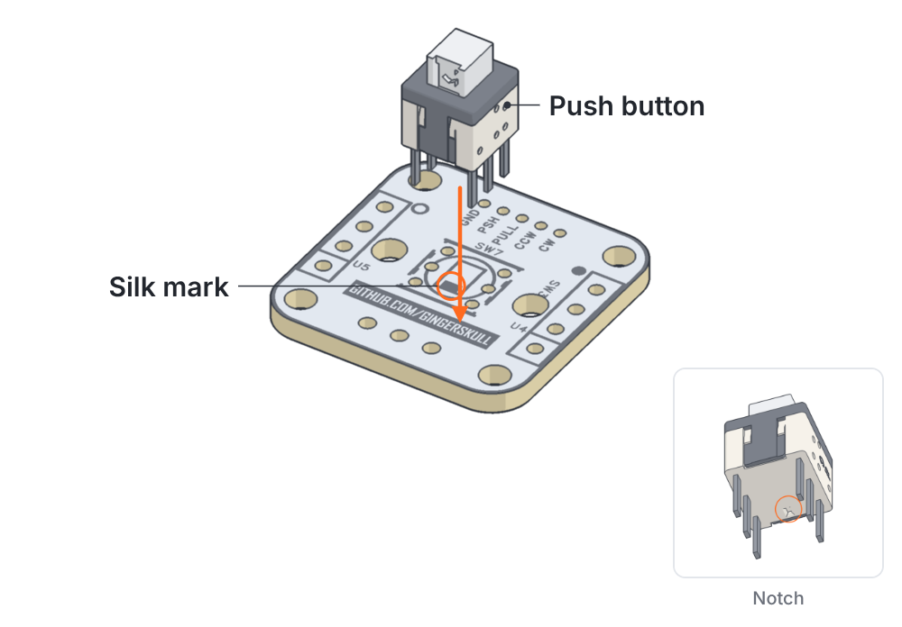</picture>

### 1 · Push button

<kbd>Button side</kbd>

Fit SW7 with the notch on its underside **opposite** the filled mark in the SW7 outline.

> [!WARNING]
> Fitted the other way round, the switch works as normally closed.

> [!TIP]
> Trim the legs after soldering.

  

<picture><source media="(prefers-color-scheme: dark)" srcset="img/20mm/step-02-dark.png">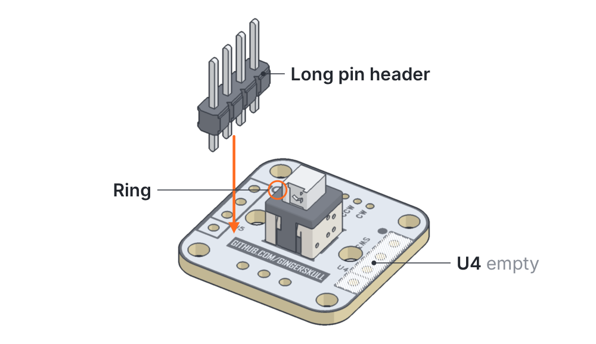</picture>

### 2 · Long pin header

<kbd>U5</kbd>

Long pin header into **U5**, next to the ring. U4 stays empty on this board.

> [!TIP]
> Keep it square to the board, since these pins go into the top board's female header later.

  

<picture><source media="(prefers-color-scheme: dark)" srcset="img/20mm/step-03-dark.png">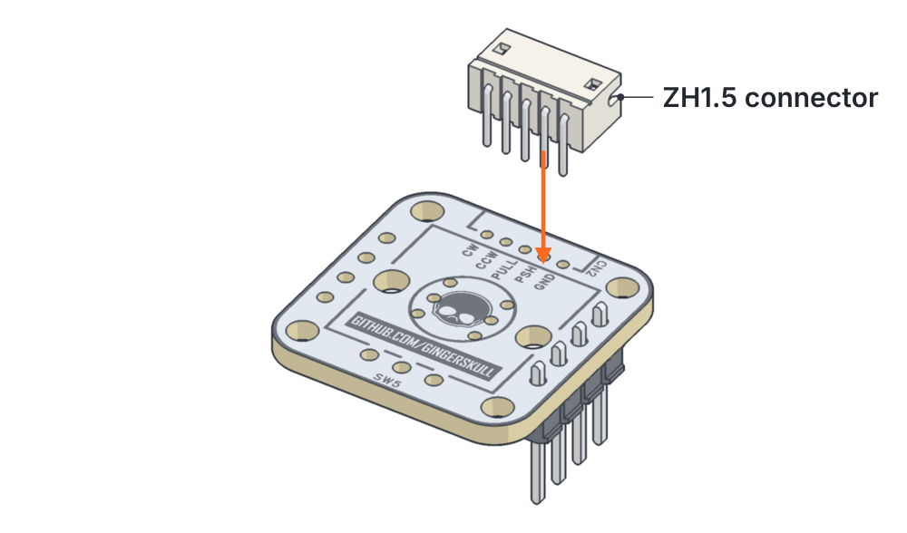</picture>

### 3 · ZH connector

<kbd>Flip</kbd>

Flip the board. Fit CN2 with the opening facing the board edge.

  

---

## B · Top board

<picture><source media="(prefers-color-scheme: dark)" srcset="img/20mm/step-04-dark.png"></picture>

### 4 · Push button

<kbd>Button side</kbd>

Same as step 1: notch opposite the silk mark.

> [!IMPORTANT]
> Trim the legs **flush**. The encoder sits right over them.

  

<picture><source media="(prefers-color-scheme: dark)" srcset="img/20mm/step-05-dark.png">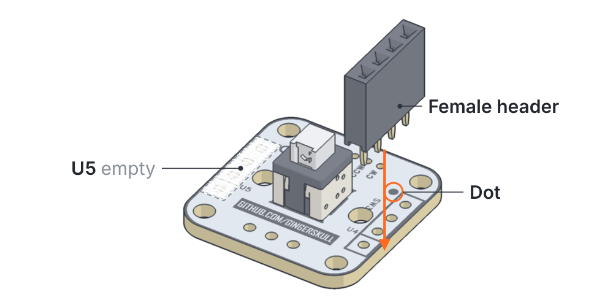</picture>

### 5 · Female header

<kbd>U4</kbd>

Female header into **U4**, next to the dot. U5 stays empty on this board.

> [!NOTE]
> When the boards stack, the dot sits over the ring.

  

<picture><source media="(prefers-color-scheme: dark)" srcset="img/20mm/step-06-dark.png">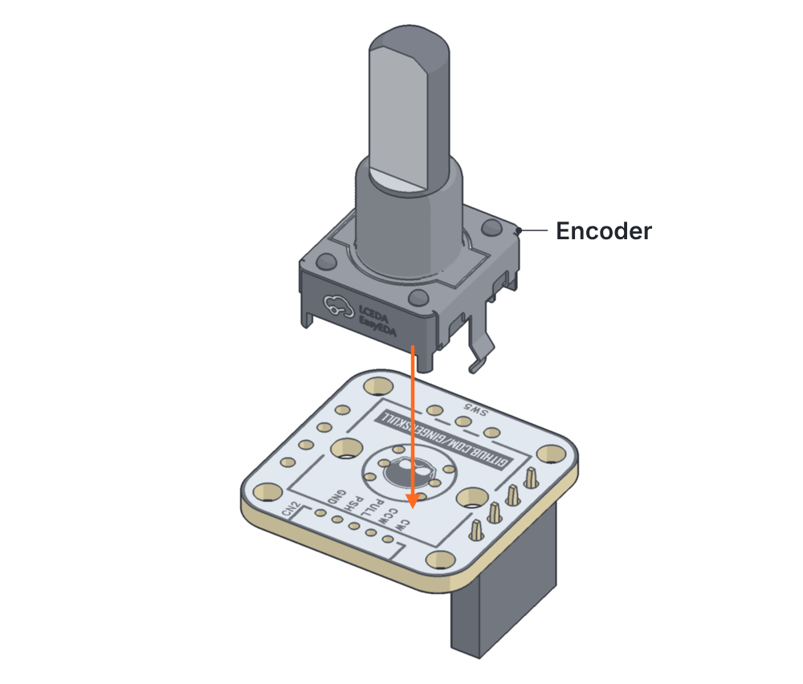</picture>

### 6 · Encoder

<kbd>Flip</kbd>

Flip the board and fit the encoder.

> [!TIP]
> Solder the mounting tabs too. They carry the push and pull load.

  

---

## C · Assembly

<picture><source media="(prefers-color-scheme: dark)" srcset="img/20mm/asm-dark.gif">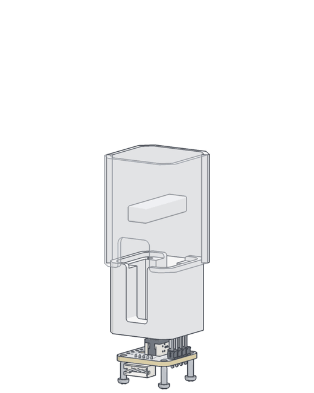</picture>

<picture><source media="(prefers-color-scheme: dark)" srcset="img/20mm/step-07-dark.png">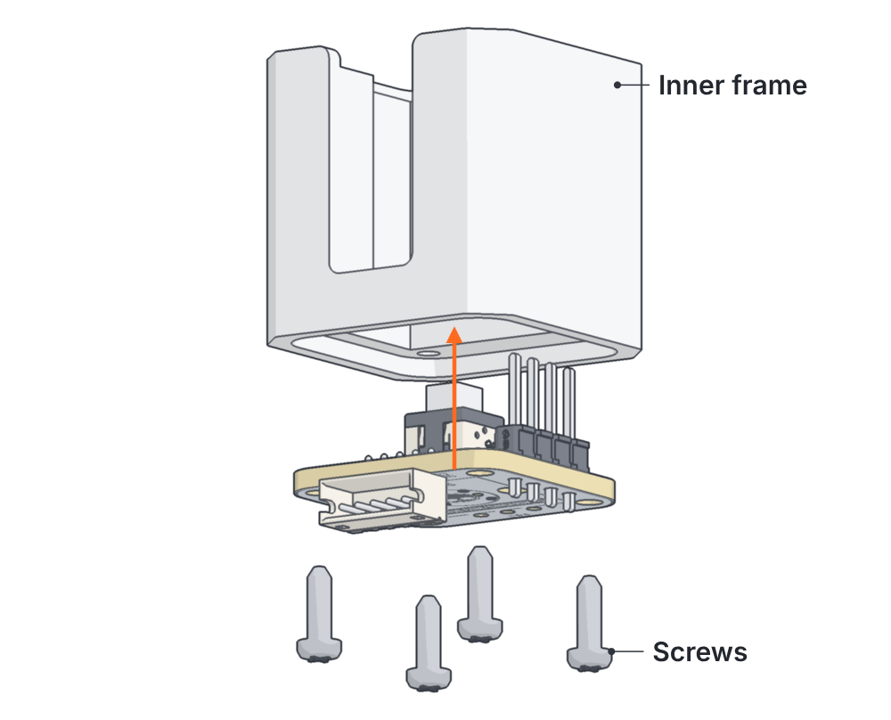</picture>

### 7 · Bottom board onto the frame

<kbd>4 × M2</kbd>

Button side into the frame, then four self-tapping screws.

> [!CAUTION]
> Tighten them only until snug. They cut their own threads in the plastic.

  

<picture><source media="(prefers-color-scheme: dark)" srcset="img/20mm/step-08-dark.png">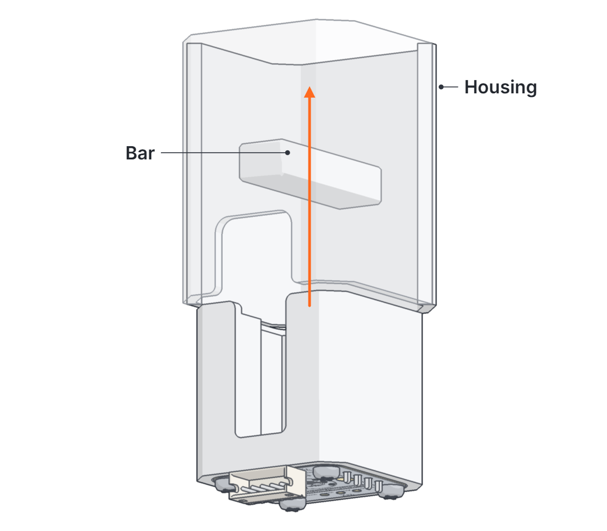</picture>

### 8 · Into the housing

<kbd>From below</kbd>

Slide the frame up into the housing. The slots pass over the bar and the connector lines up with the cutout.

> [!NOTE]
> This puts the bar between the two push buttons.

  

<picture><source media="(prefers-color-scheme: dark)" srcset="img/20mm/step-09-dark.png">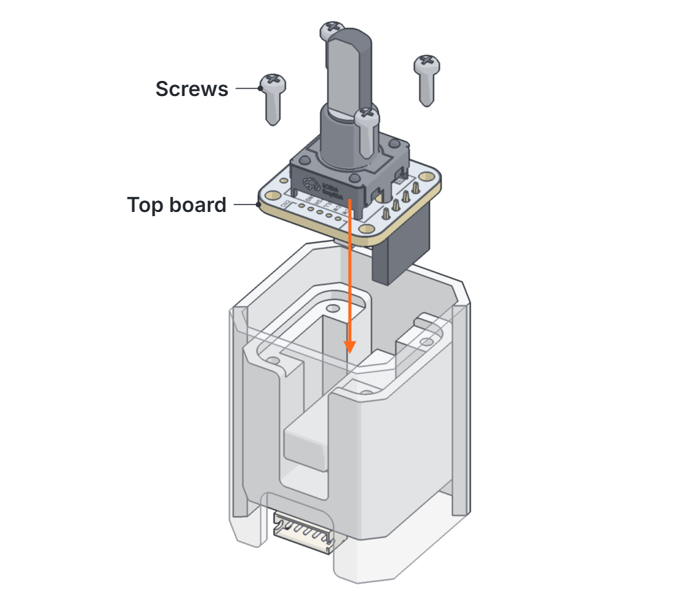</picture>

### 9 · Top board

<kbd>4 × M2</kbd>

Lower the female header onto the long pins, dot over the ring, and screw the board down.

> [!TIP]
> Check the pins line up before you push down.

  

<picture><source media="(prefers-color-scheme: dark)" srcset="img/20mm/step-10-dark.png">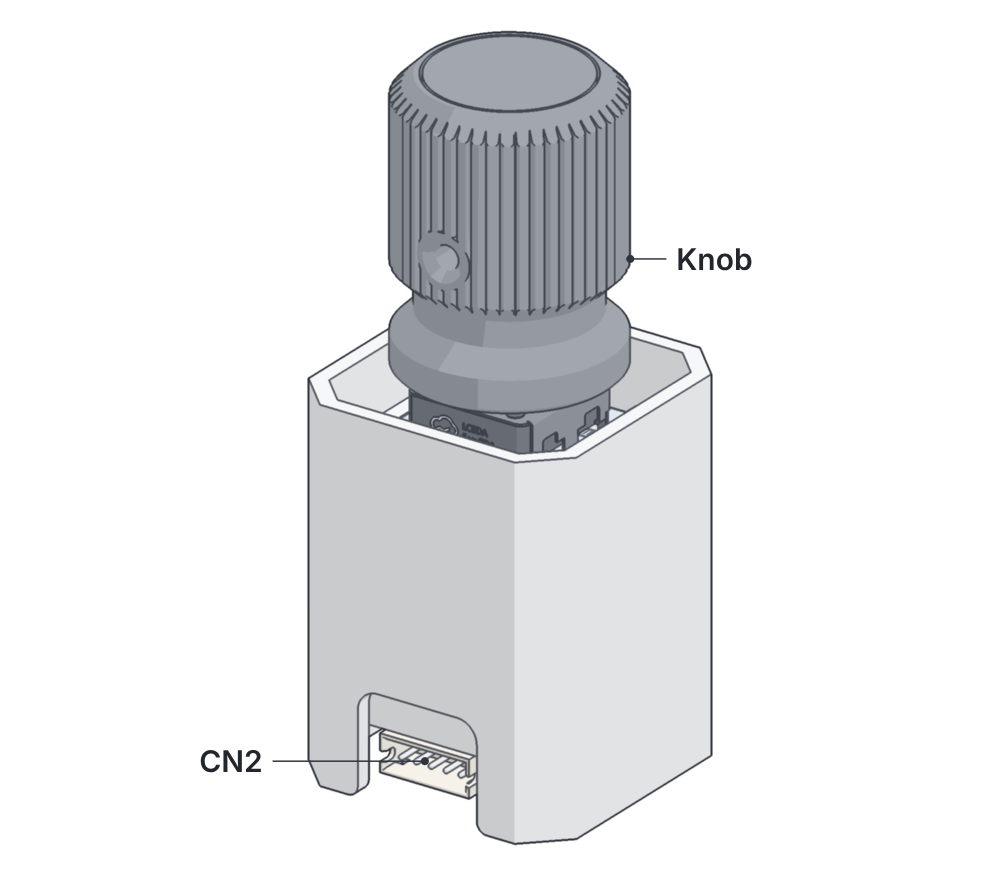</picture>

### 10 · Done

Fit the knob and plug in the cable.

| CN2 pin | Signal |
|:---:|:---|
| 1 | GND |
| 2 | PULL |
| 3 | PUSH |
| 4 | CCW (A) |
| 5 | CW (B) |

  

[← Back to the overview](../README.md)
